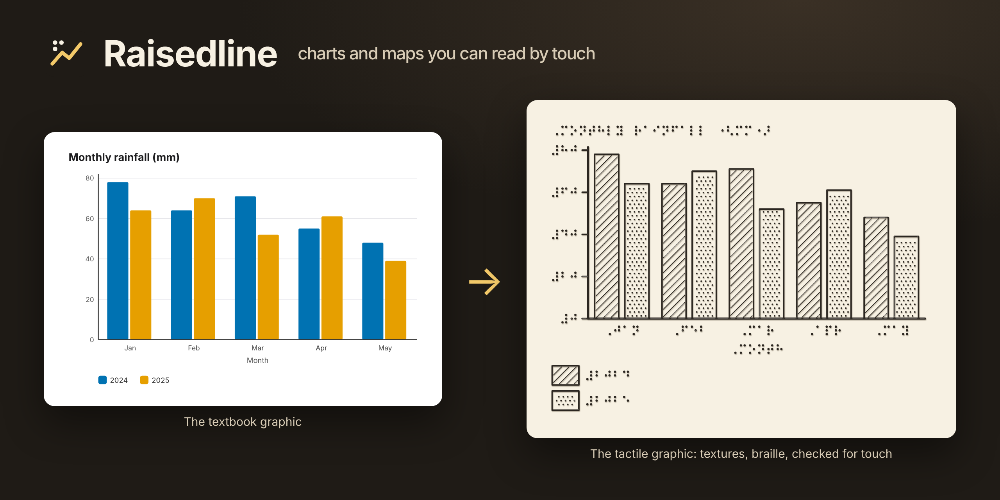
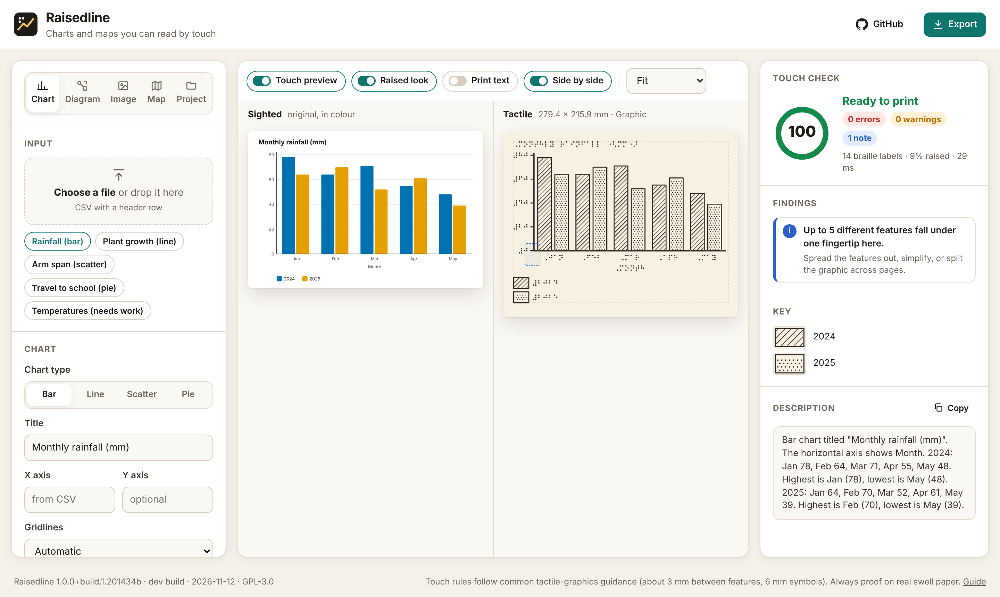
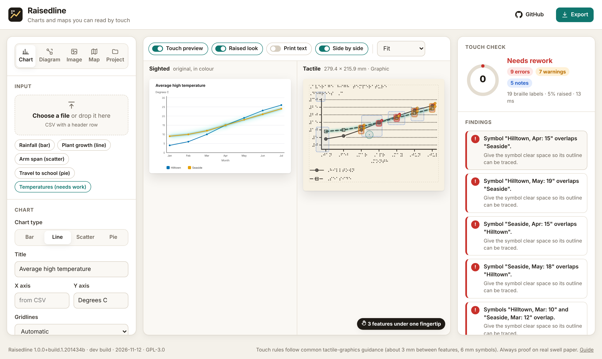
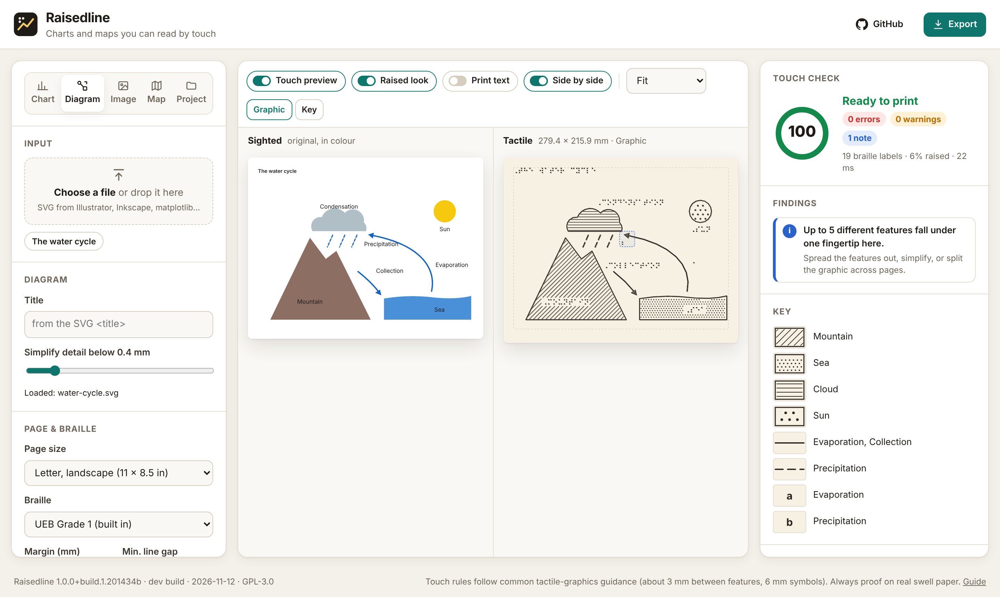
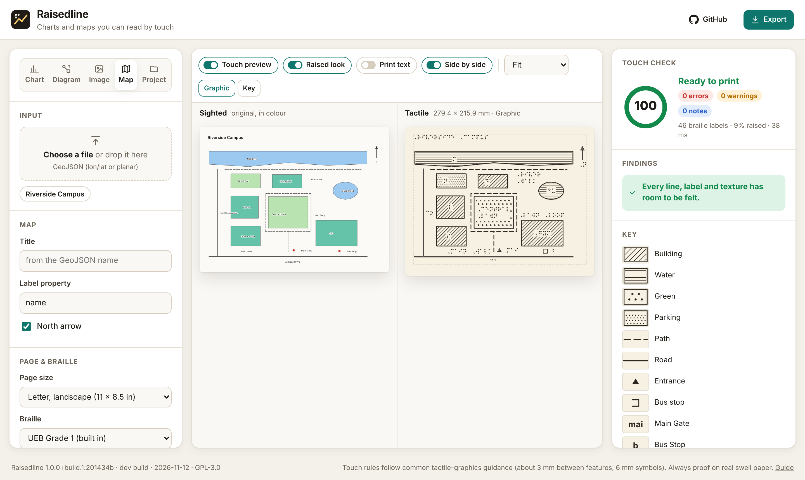
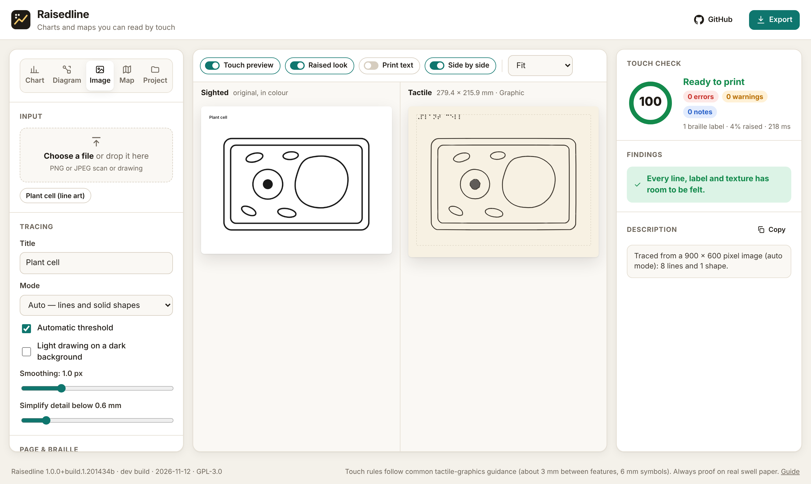
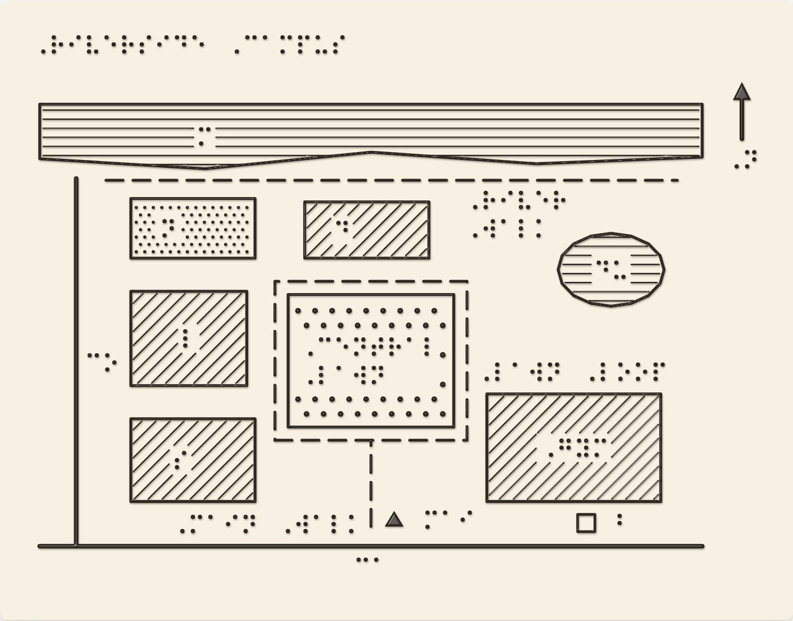
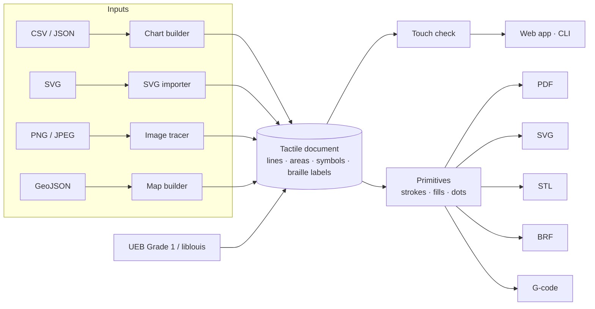

<p align="center">
  
</p>

<p align="center">
  <a href="https://github.com/lobojoel2003/Raisedline/actions/workflows/ci.yml"></a>
  <a href="https://github.com/lobojoel2003/Raisedline/releases/latest"></a>
  <a href="LICENSE"></a>
  
  
</p>

# Raisedline

**Charts and maps you can read by touch.** Raisedline turns the graphs, diagrams, pictures
and maps in a textbook into tactile graphics for blind students. It redraws them with
textures, line styles and braille labels, then checks that every line, label and texture
has enough room to be felt before you print on swell paper, emboss them or 3D print them.

It runs in the browser with nothing to install, works offline from a single HTML file, and
has a command-line tool for batch work.

- **Web app:** <https://lobojoel2003.github.io/Raisedline/>
- **Offline app, command-line tool and sample files:** [latest release](https://github.com/lobojoel2003/Raisedline/releases/latest)

---

## Contents

- [Why Raisedline](#why-raisedline)
- [What it does](#what-it-does)
- [Quick start](#quick-start)
- [Command line](#command-line)
- [Library](#library)
- [The touch check](#the-touch-check)
- [Output formats](#output-formats)
- [Braille](#braille)
- [How it works](#how-it-works)
- [Development](#development)
- [Versions, builds and releases](#versions-builds-and-releases)
- [Limitations](#limitations)
- [Contributing](#contributing) · [License](#license) · [Acknowledgements](#acknowledgements)

## Why Raisedline

Blind students need tactile versions of the graphs, diagrams and maps in their textbooks.
Making each one is slow, skilled handwork, so many students get them late or not at all.

- A [University of Washington study](https://digital.lib.washington.edu/researchworks/items/14b46dc0-628b-429a-b891-1e9ace8d6a64/full)
  calls tactile graphics production "labor and time intensive". It reports that one detailed
  campus map cost a school $10,000, and that 39% of the 51 transcribers it surveyed used no
  image software at all.
- The same study found that transcribers "used multiple software applications and hand tools
  to produce a single graphic". It dates from 2005, so it is worth checking with teachers and
  transcribers how much has changed.

Commercial tools exist, but the study found they were hard to install and rarely used. Open
source options are limited to projects such as
[DesktopBrailleRAP](https://github.com/braillerap/DesktopBrailleRAP), the software for a DIY
embosser, and small experiments. Raisedline aims to be the missing piece: free, install-free,
and opinionated about what a finger can actually read.

## What it does

### Sighted and tactile, side by side

Every graphic is shown twice: the original in colour and the tactile redesign, at the same
scale. Hover a bar, line, label or map region in either view and its twin lights up in the
other, so a sighted transcriber or teacher can check that nothing was lost. The tactile view
can look like raised material on swell paper, and **Print text** adds the print words under
every braille label.

<p align="center"></p>

### Touch preview

**Touch preview** marks every problem on the page and gives the cursor the size of a
fingertip, with a live count of how many separate features sit under it. Here two
temperature lines run so close together that their data points overlap. Raisedline flags
each spot, explains why it matters, and suggests a fix. Click a finding to jump to it.

<p align="center"></p>

### Four ways in

| Input                    | What Raisedline does                                                                                                                                                                                                                                                                                  |
| ------------------------ | ----------------------------------------------------------------------------------------------------------------------------------------------------------------------------------------------------------------------------------------------------------------------------------------------------- |
| **Charts** (CSV or JSON) | Bar, grouped bar, line, scatter and pie charts redesigned for touch: textures instead of colours, line styles plus point symbols, braille tick values, dotted gridlines that break around the data, a braille key, and key abbreviations when category names don't fit.                               |
| **Diagrams** (SVG)       | Imports SVGs from Illustrator, Inkscape, matplotlib and similar tools. Colours become textures and line styles, arrowheads keep their shape, text becomes braille labels placed clear of the drawing, and detail smaller than a fingertip can feel is simplified away.                                |
| **Images** (PNG, JPEG)   | Traces scans, photos of drawings and screenshots. Strokes become clean centre lines, solid shapes are filled, and in _regions_ mode colours become textures.                                                                                                                                          |
| **Maps** (GeoJSON)       | Longitude/latitude or planar data. Water, buildings, green space and parking get distinct textures; roads, paths, rivers and railways get distinct lines; places get point symbols. Labels go where they fit, then fall back to key codes and lead lines. A north arrow is added for geographic data. |

<table>
  <tr>
    <td width="50%"></td>
    <td width="50%"></td>
  </tr>
  <tr>
    <td></td>
    <td></td>
  </tr>
</table>

### Everything a transcriber needs

- **A touch check** with a 0–100 score and specific, fixable findings (see [the rules](#the-touch-check)).
- **Exports** to swell-paper PDF, SVG, STL for 3D printing, BRF for any braille embosser,
  G-code for open-source BrailleRAP embossers, PNG, and a reusable project file.
- **Braille** in Unified English Braille Grade 1 out of the box, and Grade 2 or any other
  liblouis table through the command line or `raisedline serve`.
- **A plain-language description** of every graphic, ready to paste as alt text or read aloud.
- **Accessible to blind and low-vision staff too:** keyboard navigation, screen-reader labels,
  live score announcements and reduced-motion support.

## Quick start

**In the browser.** Open the [web app](https://lobojoel2003.github.io/Raisedline/), pick an
example or drop in your own CSV, SVG, image or GeoJSON file, review the touch check, then
choose **Export**. Nothing is uploaded: everything runs on your computer.

**Offline.** Download `raisedline-<version>-offline.html` from the
[latest release](https://github.com/lobojoel2003/Raisedline/releases/latest) and open it in any
modern browser. It is the whole app in one file.

**Command line** (Node.js 20 or newer):

```bash
curl -LO https://github.com/lobojoel2003/Raisedline/releases/latest/download/raisedline-1.0.0.mjs
```

```bash
node raisedline-1.0.0.mjs chart rainfall.csv --title "Monthly rainfall" -f pdf,stl,brf
```

Or install the npm package from the release so `raisedline` is on your path, then start the
web app locally with liblouis support:

```bash
npm install -g https://github.com/lobojoel2003/Raisedline/releases/latest/download/raisedline-1.0.0.tgz
```

```bash
raisedline serve
```

**From source:**

```bash
git clone https://github.com/lobojoel2003/Raisedline.git && cd Raisedline && npm ci && npm run build
```

```bash
npm run dev
```

## Command line

```text
raisedline <command> [input] [options]

  chart <data.csv|spec.json>   Tactile bar, line, scatter or pie chart from data
  svg <diagram.svg>            Redesign an SVG diagram as a tactile graphic
  trace <image.png|jpg>        Trace a scan or picture into raised lines and areas
  map <map.geojson>            Tactile map from GeoJSON (geographic or planar)
  check <file>                 Run the touch check on a document or any input
  export <doc.raisedline.json> Export a saved document to other formats
  braille <text>               Translate text to braille (Unicode or BRF)
  serve                        Open the Raisedline web app locally (with liblouis)
  pages                        List page sizes
```

Common options: `-o/--out`, `-f/--format pdf,svg,stl,brf,gcode,json,report`, `--title`,
`--page letter-landscape|a4-portrait|braille|…`, `--margin`, `--braille liblouis:<table>`,
`--grade2`, `--interline`, `--mirror`, `--strict`, `--json`. Run `raisedline <command> --help`
for everything else.

```console
$ raisedline map examples/riverside-campus.geojson -f pdf,brf
Riverside Campus — 2 pages, 279.4 × 215.9 mm
  note: The key is on its own page.
Touch score 100/100 — Ready to print (0 errors, 0 warnings, 0 notes)
wrote riverside-campus-tactile.pdf
wrote riverside-campus-tactile.brf
```

`raisedline check` exits with status 1 when it finds errors (or warnings, with `--strict`), so
a school or publisher can run it over a folder of graphics in CI.

## Library

`@raisedline/core` has no DOM dependency: the same code runs in the web app and in Node.js.

```ts
import { buildChart, chartFromCsv, checkDocument, exportPdf, exportStl } from '@raisedline/core';

const spec = chartFromCsv(csvText, { type: 'bar', title: 'Monthly rainfall (mm)' });
const { tactile, sighted } = buildChart(spec);

const report = checkDocument(tactile, { minLineGap: 3 });
console.log(
  report.score,
  report.issues.map((i) => i.message),
);

const pdf: Uint8Array = exportPdf(tactile);
const stl: Uint8Array = exportStl(tactile, { baseThickness: 1.6 });
```

Other entry points: `importSvg`, `traceImage`, `buildMap`, `renderTactileSvg`, `exportBrf`,
`exportGcode`, `translateUebGrade1`, `createTranslator` (plug in any braille engine), and the
document model in [`types.ts`](packages/core/src/types.ts).

## The touch check

Defaults follow widely used tactile-graphics guidance, such as the BANA _Guidelines and
Standards for Tactile Graphics_. Every threshold can be changed (`--min-gap`, `--rules
rules.json`, or the settings panel).

| Rule             | Default                              | Why it matters                                             |
| ---------------- | ------------------------------------ | ---------------------------------------------------------- |
| Line gap         | 3 mm (1/8 in) clear                  | Closer lines merge into one under the finger.              |
| Fold-back        | 3 mm                                 | A line whose turns are closer than this feels like a blob. |
| Shallow crossing | under 25°                            | Lines that meet at a sharp angle can't be told apart.      |
| Label clearance  | 3 mm                                 | Braille touching a line or another label can't be read.    |
| Symbol size      | 6 mm (1/4 in)                        | Smaller symbols can't be identified by shape.              |
| Textured area    | 12.7 mm (1/2 in) across              | The pattern needs room to be recognised.                   |
| Dash pattern     | 12.7 mm long                         | Short dashed lines feel like solid ones.                   |
| Line width       | 0.5 mm                               | Thinner lines may not raise on swell paper.                |
| Crowding         | 4 features per 15 mm fingertip       | Clutter slows reading and causes errors.                   |
| Variety          | 5 textures, 4 line styles, 5 symbols | More than this is hard to remember and tell apart.         |
| Page             | margin and page edge                 | Paper handling flattens features at the edges.             |
| Title and key    | present                              | Readers need to know what they are exploring.              |

Findings are grouped so one problem gives one message, and lines that are _meant_ to touch
(a data point on its line, a tick on its axis, a lead line to its label) are not flagged.

## Output formats

| Format     | For                                                                              | Notes                                                                                                                                                                                                 |
| ---------- | -------------------------------------------------------------------------------- | ----------------------------------------------------------------------------------------------------------------------------------------------------------------------------------------------------- |
| **PDF**    | Swell (microcapsule) paper, graphics embossers                                   | Vector, black only, true physical size, with the key page when there is one; _proof_ mode adds print labels and transcriber notes. Print at 100% scale.                                               |
| **SVG**    | Editing in other tools                                                           | Real-world millimetre units.                                                                                                                                                                          |
| **STL**    | 3D printing                                                                      | A base plate with raised lines (1 mm), lower textures (0.55 mm) and domed braille dots; the top-right corner is cut so the reader can orient the page.                                                |
| **BRF**    | Any braille embosser                                                             | The graphic drawn with braille cells on the embosser's cell grid, real braille cells for labels, then the key and description as braille text. Resolution is limited by the cell grid.                |
| **G-code** | [BrailleRAP](https://github.com/braillerap/DesktopBrailleRAP)-style XY embossers | Same dialect as DesktopBrailleRAP: `G28 X/Y`, `G1` moves in mm, `M3 S1`/`M3 S0` to strike a dot; dots ordered row by row in a serpentine path. Use `--mirror` if your machine embosses from the back. |
| **PNG**    | Worksheets, slides                                                               | From the web app, at 200 dpi.                                                                                                                                                                         |
| **JSON**   | Saving work                                                                      | A `.raisedline.json` project you can reopen or export with the CLI.                                                                                                                                   |

## Braille

- The **built-in translator** produces Unified English Braille Grade 1 (uncontracted):
  capital letter, word and passage indicators, numbers with the numeric and grade 1
  indicators, punctuation, currency, maths signs, arrows, accented and Greek letters. Its
  output is tested against liblouis on every CI run.
- **liblouis** provides contracted (Grade 2) braille and other languages. With liblouis
  installed (`apt install liblouis-bin`, `brew install liblouis`), use `--grade2` or
  `--braille liblouis:<table>` on the command line, or run `raisedline serve` to use any
  installed table from the web app.
- Type a label **directly in braille** to control it exactly: Unicode braille (`⠠⠓⠊`) or
  Braille ASCII in `{brf:,HI}`.
- Cell geometry defaults to 2.5 mm dot spacing, 6.2 mm cell spacing, 10 mm line spacing and
  1.5 mm dots.

## How it works



1. A **builder** turns the input into a tactile document: a page in millimetres holding lines
   with tactile styles, textured areas, point symbols and braille labels, plus a key and a
   plain-language description. Builders lay out labels with a collision-aware placer and
   fall back to key abbreviations and lead lines.
2. The **touch check** measures the document with a spatial index and segment geometry, then
   scores it.
3. Every exporter works from the same flattened **primitives** (strokes, fills and dots),
   so what you see is what gets printed, embossed or 3D printed. Textures are clipped to their
   areas and knocked out around braille.

The image tracer is an OpenCV-style pipeline written in TypeScript so the app needs nothing
installed: grayscale and Gaussian blur, Otsu threshold, morphological closing, connected
components, distance transform to separate strokes from solid shapes, Zhang–Suen thinning
with staircase removal, skeleton graph tracing, marching squares, Ramer–Douglas–Peucker
simplification and Chaikin smoothing, plus k-means colour regions.

## Development

```text
packages/
  core/   @raisedline/core — model, braille, geometry, builders, touch check, exporters
  cli/    raisedline — command-line tool and local server (bundled with esbuild)
  web/    the web app (React + Vite)
examples/ sample inputs used by tests, the app and the release
e2e/      Playwright tests for the web app
scripts/  build info, version checks and bumps, release packaging, screenshots
docs/     guide and images
```

| Command                   | What it does                                                           |
| ------------------------- | ---------------------------------------------------------------------- |
| `npm ci`                  | Install dependencies (Node.js 22.12 or newer)                          |
| `npm run dev`             | Web app with hot reload                                                |
| `npm run build`           | Build the library, web app, single-file app and CLI                    |
| `npm test`                | Unit and CLI tests (Vitest)                                            |
| `npm run test:e2e`        | Browser tests (Playwright; run `npx playwright install chromium` once) |
| `npm run check`           | Typecheck, lint, format check and tests, as CI does                    |
| `npm run screenshots`     | Regenerate the README images from the real app                         |
| `npm run release:package` | Collect release artifacts in `./release`                               |

Install liblouis to also run the tests that compare the built-in translator with it.

## Versions, builds and releases

- **Semantic versioning.** All packages share one version, kept in sync with
  `packages/core/src/version.ts` and the [changelog](CHANGELOG.md); CI fails if they disagree.
- **Build numbers.** Every build is stamped with a build number (the CI run number, or the
  git commit count locally), the commit and the date: `raisedline --version` prints
  `raisedline 1.0.0+build.42.3f2a1bc (release, built 2026-11-12)`, and the web app shows the
  same in its footer.
- **Continuous integration** ([`ci.yml`](.github/workflows/ci.yml)) runs on every push and pull
  request: version consistency, typecheck, lint, formatting, unit tests on Node 22 and 24 with
  liblouis, the full build, CLI smoke tests on Linux, macOS and Windows, and the Playwright
  browser tests. Build outputs are uploaded as artifacts.
- **Continuous deployment** ([`pages.yml`](.github/workflows/pages.yml)) publishes the web app
  to GitHub Pages from `main`.
- **Releases** ([`release.yml`](.github/workflows/release.yml)) run when a `v*` tag is pushed,
  or from **Actions → Release → Run workflow** with a tag name (the tag is then created on the
  commit that was built). They check that the tag matches the version, run the tests, build,
  package the artifacts with SHA-256 checksums, and publish a GitHub Release with notes from
  the changelog.

To cut a release:

```bash
npm run version:bump -- minor
```

```bash
git commit -am "chore(release): v1.1.0" && git tag -a v1.1.0 -m "v1.1.0" && git push --follow-tags
```

## Limitations

- **Always proof on real material.** The touch check catches common problems; it does not
  replace a trained transcriber or a reader's feedback. Swell paper, embossers and printers
  vary, so make a test print with your own equipment.
- The built-in translator is **Grade 1 only**. Use liblouis for contracted braille.
- **BRF graphics** are limited to the braille cell grid (about 2.5 mm resolution); use PDF on
  swell paper or a graphics embosser for fine detail.
- **SVG import** covers the common SVG features used for diagrams; filters, masks, clipping
  paths, gradients (treated as one texture) and embedded images are ignored. Text converted
  to outlines cannot become braille, so keep text as text.
- **Map labels** are placed automatically; dense maps may need some labels moved by hand or a
  larger page.
- The evidence above dates from 2005. Talk to the teachers of the visually impaired and
  transcribers you work with about what they need today.

See the [guide](docs/guide.md) for tips on preparing graphics for touch.

## Contributing

Contributions are welcome, especially from braille transcribers, teachers of the visually
impaired and tactile readers. Please read [CONTRIBUTING.md](CONTRIBUTING.md). Report security
issues as described in [SECURITY.md](SECURITY.md).

## License

Raisedline is free software under the [GNU General Public License v3.0 or later](LICENSE).

## Acknowledgements

- [liblouis](https://liblouis.io) for braille translation tables.
- [BrailleRAP](https://github.com/braillerap/DesktopBrailleRAP) for the open-source embosser
  and its G-code dialect.
- The Braille Authority of North America's tactile graphics guidance, which informs the
  default touch rules.
- [earcut](https://github.com/mapbox/earcut) for polygon triangulation in the STL exporter.
